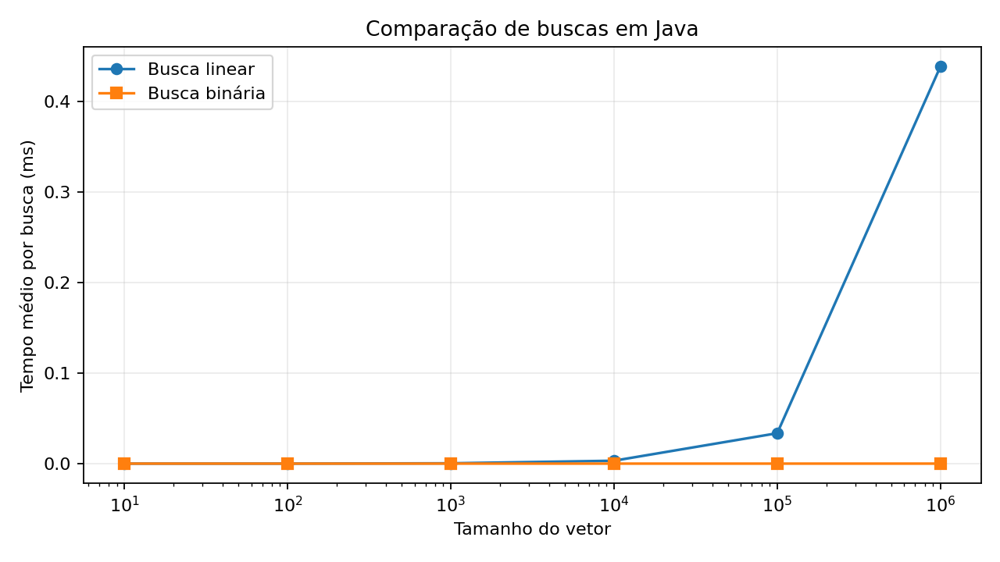

# U1 — Aula 1: Análise Assintótica

**Atividade:** Busca Linear × Busca Binária

## Implementação

A busca linear percorre o vetor elemento por elemento até encontrar o alvo. A busca binária utiliza `Arrays.binarySearch()` do Java em vetor previamente ordenado. Os vetores contêm inteiros pares em ordem crescente, e o alvo é o último elemento (pior caso para a busca linear).

## Metodologia

Para cada tamanho, foi feito aquecimento da JVM e foram medidas cinco rodadas de lotes de buscas. Os valores representam a média de tempo **por busca** em milissegundos. Os dados abaixo foram medidos neste ambiente de execução, não no computador do aluno. Os tempos podem variar conforme hardware, JVM e carga do sistema.

## Resultados

| Tamanho do vetor | Busca Linear (ms) | Busca Binária (ms) |
|---:|---:|---:|
| 10 | 0.000033687 | 0.000024854 |
| 100 | 0.000046801 | 0.000014893 |
| 1000 | 0.000390066 | 0.000022096 |
| 10000 | 0.003201498 | 0.000014401 |
| 100000 | 0.033547942 | 0.000016410 |
| 1000000 | 0.438199318 | 0.000026984 |



## Análise comparativa

A busca linear tem complexidade **O(n)** no pior caso, pois pode precisar verificar todos os elementos. A busca binária tem complexidade **O(log n)**, pois reduz aproximadamente pela metade o intervalo de busca a cada passo. Nos resultados, o tempo da busca linear cresce significativamente com o tamanho do vetor, enquanto o tempo da busca binária permanece muito pequeno. Os tempos da busca binária são tão curtos que pequenas variações de medição podem causar oscilações.

## Conclusão

A busca binária apresentou desempenho superior para vetores ordenados, sobretudo nos maiores tamanhos. A busca linear é simples e funciona sem ordenação, mas pode se tornar lenta para conjuntos grandes.

## Ambiente e reprodução

Medições realizadas com OpenJDK 21 em ambiente Linux de execução. Para repetir em seu computador:

```bash
javac ComparaBuscas.java
java ComparaBuscas
```

Os resultados em CSV estão em `resultados.csv`.

## Uso de IA

Código, organização do experimento e texto de apoio produzidos com auxílio do ChatGPT. Revise e adapte antes de entregar.